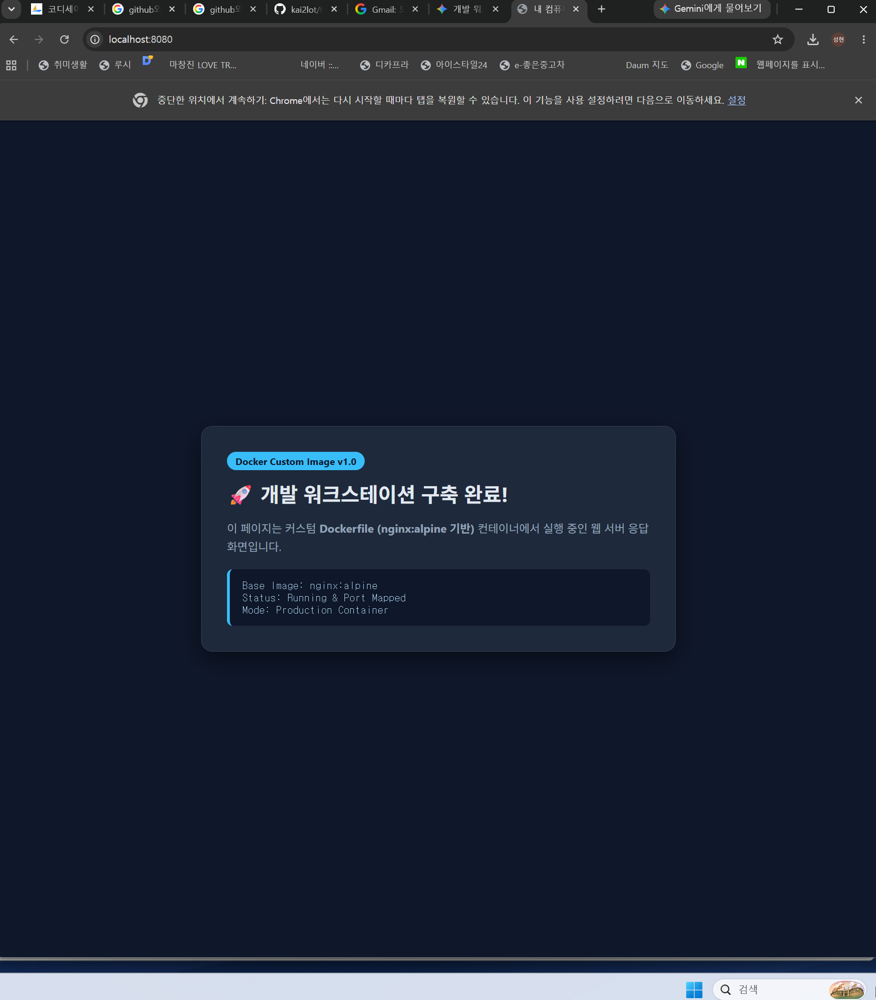
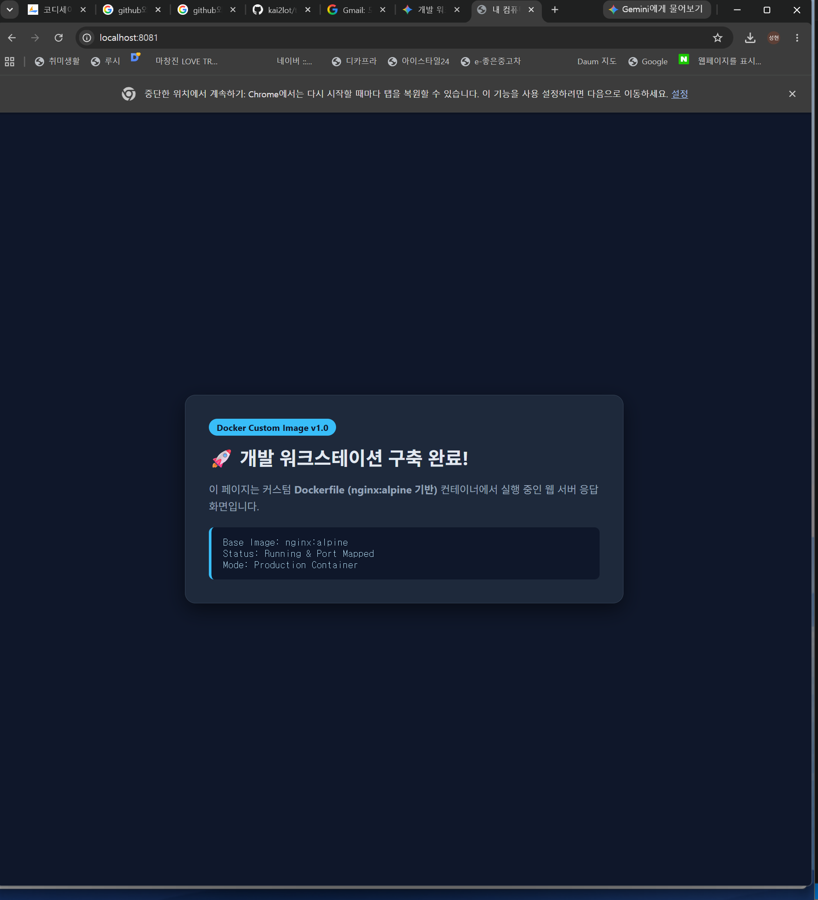
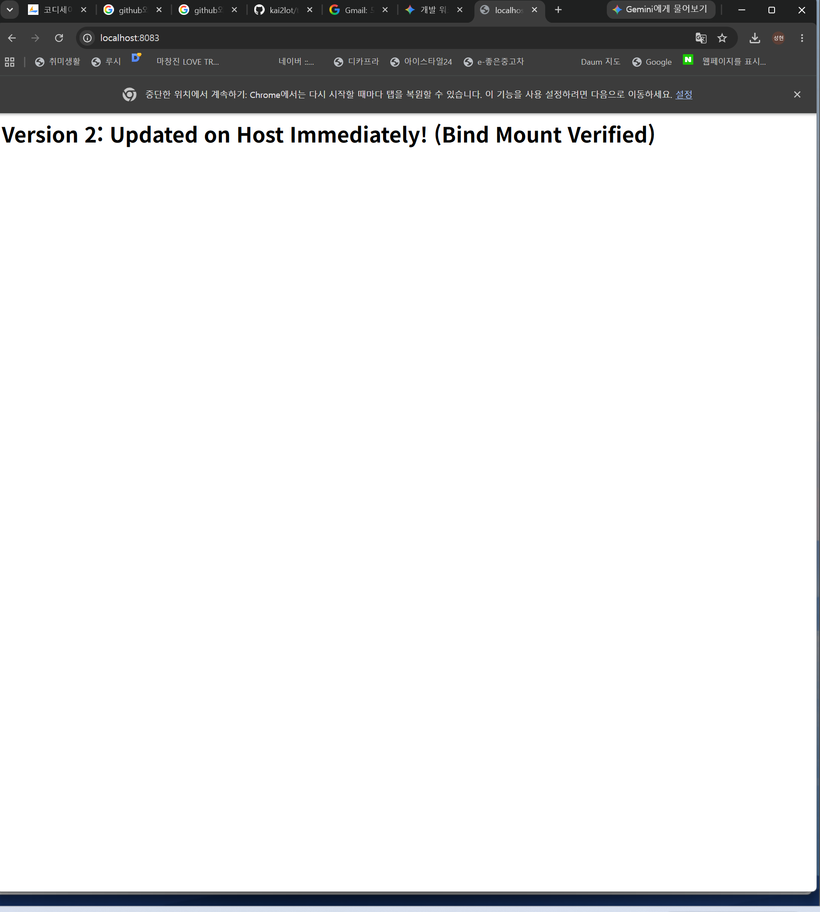
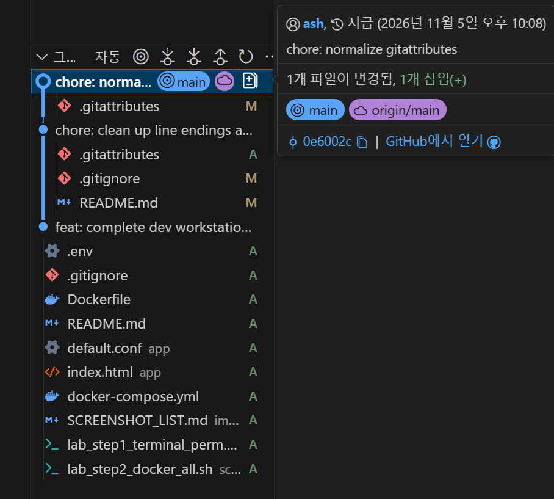

# 🛠️ 내 컴퓨터에 개발자용 '작업실' 꾸미기 (Development Workstation Setup)

## 1. 프로젝트 개요 (미션 목표 요약)

개발은 코드를 작성하는 순간이 아니라, **언제 어디서나 동일하게 재현 가능한 실행 환경(워크스테이션)을 구축하는 순간**부터 시작됩니다.  
본 프로젝트에서는 개발자의 3대 핵심 기반 도구인 **Linux CLI(터미널), Docker(컨테이너), Git/GitHub(버전 관리 및 협업)**를 직접 구성하고 검증하여, *"내 컴퓨터에서만 돌아가는 문제"*를 해결하고 팀원 누구나 같은 방식으로 빌드·실행·배포·디버깅할 수 있는 표준 워크스테이션 환경을 완성했습니다.

### 핵심 달성 목표
1. **리눅스 터미널(CLI) 및 파일 시스템 권한 제어**: 디렉토리 계층 설계, 파일 조작, `r/w/x` 및 8진수 권한(`755`, `644`) 체계 검증
2. **Docker 컨테이너 라이프사이클 운영**: 이미지와 컨테이너 분리 원칙 이해, `hello-world` 및 `ubuntu` 컨테이너 실행·진입(`exec`)·모니터링(`logs`, `stats`)
3. **커스텀 `Dockerfile` 설계 및 멀티 포트 매핑**: `nginx:alpine` 기반 커스텀 이미지(`my-web:1.0`) 빌드, 헬스체크/환경변수 주입, 호스트 포트 매핑(`8080:80`, `8081:80`) 접속 검증
4. **스토리지 연결 방식 검증 (Bind Mount & Volume)**:
   - **바인드 마운트(Bind Mount)**: 호스트 소스 코드 수정 시 컨테이너 재빌드 없이 즉시 반영됨을 검증 (`8083:80`)
   - **도커 볼륨(Docker Volume)**: 컨테이너(`vol-test`)가 삭제된 이후에도 볼륨(`mydata`)을 통해 데이터가 영속적으로 유지됨을 증명 (`vol-test2`)
5. **Git/GitHub 버전 관리 및 보너스 과제(Docker Compose, SSH 인증)**: 멀티 컨테이너(`web` + `cache-redis`) 네트워크/서비스 디스커버리 구성, `.env` 환경 변수 분리, GitHub 연동 및 SSH 키 기반 인증 구성 완료

---

## 2. 실행 환경 (Execution Environment)

| 항목 | 상세 사양 및 버전 | 확인 명령어 |
| :--- | :--- | :--- |
| **Host OS** | Windows 11 Pro (WSL2 Backend 연동) | `wsl -l -v` |
| **Linux OS (WSL2)** | **Ubuntu 24.04.5 LTS (Noble Numbat)** (`x86_64`, Kernel `6.18.54.1-microsoft-standard-WSL2`) | `cat /etc/os-release`, `uname -a` |
| **Shell / Terminal** | **GNU bash, version 5.2.21(1)-release** (`x86_64-pc-linux-gnu`) | `bash --version` |
| **Docker Engine** | **Docker version 29.1.3**, build `29.1.3-0ubuntu3~24.04.2` | `docker --version` |
| **Docker Compose** | **Docker Compose version 2.40.3** (`+ds1-0ubuntu1~24.04.1`) | `docker compose version` |
| **Git Version** | **git version 2.43.0** (Ubuntu WSL) / **2.56.0.windows.4** (Host) | `git --version` |

```bash
$ uname -a
Linux GNIA-C402-H02 6.18.54.1-microsoft-standard-WSL2 #1 SMP PREEMPT_DYNAMIC Tue Oct  6 19:13:07 UTC 2026 x86_64 x86_64 x86_64 GNU/Linux

$ cat /etc/os-release | head -n 4
PRETTY_NAME="Ubuntu 24.04.5 LTS"
NAME="Ubuntu"
VERSION_ID="24.04"
VERSION="24.04.5 LTS (Noble Numbat)"

$ bash --version | head -n 1
GNU bash, version 5.2.21(1)-release (x86_64-pc-linux-gnu)

$ docker --version
Docker version 29.1.3, build 29.1.3-0ubuntu3~24.04.2

$ docker compose version
Docker Compose version 2.40.3+ds1-0ubuntu1~24.04.1

$ git --version
git version 2.43.0
```

---

## 3. 수행 항목 체크리스트 및 검증 결과 링크

- [x] **터미널 기본 조작 및 폴더 구성** (`pwd`, `ls -la`, `cd`, `mkdir -p`, `touch`, `cp`, `mv`, `rm`, `cat`) 👉 [4.1 터미널 조작 로그](#41-터미널-기본-조작-로그)
- [x] **파일 및 디렉토리 권한 변경 실습** (`chmod 644`, `chmod 755`, 변경 전/후 비교 및 스크립트 실행) 👉 [4.2 권한 실습 및 증거 기록](#42-권한-실습-및-증거-기록)
- [x] **Docker 설치 및 데몬 동작 점검** (`docker --version`, `docker info`) 👉 [5.1 Docker 설치 및 기본 점검](#51-docker-설치-및-기본-점검)
- [x] **Docker 기본 운영 및 컨테이너 실행 실습** (`hello-world`, `ubuntu` 백그라운드 실행 및 `docker exec`, `images`, `ps -a`, `logs`, `stats`) 👉 [5.2 컨테이너 실행 및 운영 실습](#52-컨테이너-실행-및-기본-운영-명령-실습)
- [x] **커스텀 `Dockerfile` 기반 웹 서버 이미지 제작** ([`Dockerfile`](./Dockerfile), [`app/index.html`](./app/index.html), [`app/default.conf`](./app/default.conf)) 👉 [6. 커스텀 Dockerfile 이미지 제작](#6-커스텀-dockerfile-기반-웹-서버-컨테이너-제작)
- [x] **포트 매핑 접속 검증 (2회 이상: `8080:80`, `8081:80`)** 👉 [7. 포트 매핑 및 접속 증거](#7-포트-매핑-및-접속-증거)
- [x] **바인드 마운트(Bind Mount) 호스트 파일 변경 즉시 반영 검증 (`8083:80`)** 👉 [8.1 바인드 마운트 실시간 반영 검증](#81-바인드-마운트bind-mount-실시간-변경-반영-검증)
- [x] **Docker 볼륨(Volume) 컨테이너 삭제 전/후 데이터 영속성 검증 (`mydata`)** 👉 [8.2 Docker 볼륨 영속성 검증](#82-docker-볼륨volume-영속성-검증)
- [x] **Git 사용자/기본 브랜치(`main`) 설정 및 GitHub/VSCode 연동** 👉 [9. Git 설정 및 GitHub 연동 증거](#9-git-설정-및-github--vscode-연동-증거)
- [x] **트러블슈팅 2건 이상 기록 (문제 → 원인 가설 → 확인 → 해결)** 👉 [11. 트러블슈팅 (Troubleshooting)](#11-트러블슈팅-troubleshooting---문제--원인-가설--확인--해결)
- [x] **[보너스 과제] Docker Compose 멀티 컨테이너 + 환경변수(`.env`) + 네트워크 통신 + SSH 키 설정** 👉 [12. 보너스 과제 수행 내역](#12-보너스-과제-수행-내역-docker-compose--환경-변수--ssh)

### 검증 방법 요약 테이블

| 검증 항목 | 검증 명령어 | 결과 확인 위치 |
| :--- | :--- | :--- |
| 터미널/권한 자동 재현 | `bash scripts/lab_step1_terminal_perm.sh` | [4장 로그](#4-터미널-조작-및-권한-실습-로그) / [`scripts/lab_step1_terminal_perm.sh`](./scripts/lab_step1_terminal_perm.sh) |
| Docker/볼륨/Compose 전체 검증 | `bash scripts/lab_step2_docker_all.sh` | [5~8장 로그](#5-docker-설치점검-및-운영-로그) / [`scripts/lab_step2_docker_all.sh`](./scripts/lab_step2_docker_all.sh) |
| 커스텀 웹 서버 소스 및 설정 | `cat Dockerfile app/index.html app/default.conf` | [`Dockerfile`](./Dockerfile), [`app/`](./app) |
| 포트 매핑 접속 확인 | `curl -i http://localhost:8080` / `http://localhost:8081` | [7장 포트 매핑 증거](#7-포트-매핑-및-접속-증거) 및 `images/` 폴더 |
| 바인드 마운트 & 볼륨 검증 | `curl http://localhost:8083` / `docker volume inspect mydata` | [8장 스토리지 증거](#8-바인드-마운트-반영-및-볼륨-영속성-증거) |
| Git 설정 확인 | `git config --list` | [9장 Git 연동 증거](#9-git-설정-및-github--vscode-연동-증거) |

---

## 4. 터미널 조작 및 권한 실습 로그

### 4.1 터미널 기본 조작 로그
현재 위치 확인(`pwd`), 디렉토리 생성(`mkdir -p`), 이동(`cd`), 빈 파일 생성(`touch`), 파일 작성 및 내용 확인(`echo`, `cat`), 숨김 파일 포함 목록 확인(`ls -la`), 복사(`cp`), 이동/이름변경(`mv`), 삭제(`rm`)를 순차적으로 수행했습니다.

```bash
$ pwd
/root

$ mkdir -p ~/codyssey/practice
$ cd ~/codyssey/practice && pwd
/root/codyssey/practice

$ touch empty.txt
$ echo "Hello Dev Workstation" > hello.txt
$ cat hello.txt
Hello Dev Workstation

$ ls -la
total 12
drwxr-xr-x 2 root root 4096 Nov  5 21:34 .
drwxr-xr-x 3 root root 4096 Nov  5 21:34 ..
-rw-r--r-- 1 root root    0 Nov  5 21:34 empty.txt
-rw-r--r-- 1 root root   22 Nov  5 21:34 hello.txt

$ cp hello.txt hello_backup.txt
$ mv hello_backup.txt hello_moved.txt
$ ls -la
total 16
drwxr-xr-x 2 root root 4096 Nov  5 21:34 .
drwxr-xr-x 3 root root 4096 Nov  5 21:34 ..
-rw-r--r-- 1 root root    0 Nov  5 21:34 empty.txt
-rw-r--r-- 1 root root   22 Nov  5 21:34 hello.txt
-rw-r--r-- 1 root root   22 Nov  5 21:34 hello_moved.txt

$ rm empty.txt
$ ls -la
total 16
drwxr-xr-x 2 root root 4096 Nov  5 21:34 .
drwxr-xr-x 3 root root 4096 Nov  5 21:34 ..
-rw-r--r-- 1 root root   22 Nov  5 21:34 hello.txt
-rw-r--r-- 1 root root   22 Nov  5 21:34 hello_moved.txt
```

### 4.2 권한 실습 및 증거 기록
파일 1개(`run.sh`)와 디렉토리 1개(`my_dir`)를 대상으로 권한 변경 전/후를 비교하고 실행 권한(`x`) 부여 효과를 확인했습니다.

```bash
$ mkdir -p ~/codyssey/perm_lab/my_dir
$ echo -e '#!/bin/bash\necho "Script executed successfully!"' > ~/codyssey/perm_lab/run.sh
$ cd ~/codyssey/perm_lab
$ chmod 600 run.sh && chmod 700 my_dir

# [변경 전 권한 확인]
$ ls -ld run.sh my_dir
drwx------ 2 root root 4096 Nov  5 21:34 my_dir
-rw------- 1 root root   49 Nov  5 21:34 run.sh

$ stat -c '%a %A %n' run.sh my_dir
600 -rw------- run.sh
700 drwx------ my_dir

# [권한 변경 수행: 파일 600 -> 644 -> 755, 디렉토리 700 -> 755]
$ chmod 644 run.sh && ls -l run.sh
-rw-r--r-- 1 root root 49 Nov  5 21:34 run.sh

$ chmod 755 run.sh && chmod 755 my_dir

# [변경 후 권한 확인 및 스크립트 실행]
$ ls -ld run.sh my_dir
drwxr-xr-x 2 root root 4096 Nov  5 21:34 my_dir
-rwxr-xr-x 1 root root   49 Nov  5 21:34 run.sh

$ stat -c '%a %A %n' run.sh my_dir
755 -rwxr-xr-x run.sh
755 drwxr-xr-x my_dir

$ ./run.sh
Script executed successfully!
```

---

## 5. Docker 설치·점검 및 운영 로그

### 5.1 Docker 설치 및 기본 점검 (`docker --version`, `docker info`)
```bash
$ docker --version
Docker version 29.1.3, build 29.1.3-0ubuntu3~24.04.2

$ docker info | head -n 28
Client:
 Version:    29.1.3
 Context:    default
 Debug Mode: false
 Plugins:
  compose: Docker Compose (Docker Inc.)
    Version:  2.40.3+ds1-0ubuntu1~24.04.1
    Path:     /usr/libexec/docker/cli-plugins/docker-compose
  trust: Manage trust on Docker images (Docker Inc.)
    Version:  29.1.3
    Path:     /usr/libexec/docker/cli-plugins/docker-trust

Server:
 Containers: 5
  Running: 5
  Paused: 0
  Stopped: 0
 Images: 4
 Server Version: 29.1.3
 Storage Driver: overlayfs
  driver-type: io.containerd.snapshotter.v1
 Logging Driver: json-file
 Cgroup Driver: systemd
 Cgroup Version: 2
```

### 5.2 컨테이너 실행 및 기본 운영 명령 실습 (`hello-world`, `ubuntu`)

#### (1) `hello-world` 컨테이너 실행 검증
```bash
$ docker run --rm hello-world

Hello from Docker!
This message shows that your installation appears to be working correctly.

To generate this message, Docker took the following steps:
 1. The Docker client contacted the Docker daemon.
 2. The Docker daemon pulled the "hello-world" image from the Docker Hub.
    (amd64)
 3. The Docker daemon created a new container from that image which runs the
    executable that produces the output you are currently reading.
 4. The Docker daemon streamed that output to the Docker client, which sent it
    to your terminal.
```

#### (2) `ubuntu` 컨테이너 실행 및 내부 명령 수행
```bash
$ docker run -d --name ubuntu-lab ubuntu:24.04 sleep infinity
2cd2af543324ab1cb588b9d3888162fcb72123dbfa1363073de5596c8c72fadf

$ docker ps
CONTAINER ID   IMAGE          COMMAND            CREATED         STATUS         PORTS     NAMES
2cd2af543324   ubuntu:24.04   "sleep infinity"   2 seconds ago   Up 2 seconds             ubuntu-lab

$ docker exec ubuntu-lab bash -c "echo Hello from Ubuntu Container! > /tmp/test.txt && ls -la /tmp/test.txt && cat /tmp/test.txt"
-rw-r--r-- 1 root root 29 Nov  5 12:36 /tmp/test.txt
Hello from Ubuntu Container!
```

#### (3) 컨테이너 종료/유지 방식(`run -it` vs `attach` vs `exec`) 관찰 정리
| 구분 | 동작 방식 | `exit` 입력 시 컨테이너 상태 | 실무 활용 용도 |
| :--- | :--- | :--- | :--- |
| `docker run -it ubuntu bash` | 메인 프로세스(PID 1)로 `bash`를 포그라운드 실행 | PID 1이 종료되므로 **컨테이너도 즉시 종료(`Exited`)** | 일회성 테스트 및 디버깅 |
| `docker attach <컨테이너>` | 이미 실행 중인 컨테이너의 PID 1 표준 입출력에 직접 연결 | PID 1에 종료 시그널이 전달되어 **컨테이너가 함께 종료됨** | 실시간 표준 출력 관찰 |
| `docker exec -it <컨테이너> bash` | 실행 중인 컨테이너 내부에 **새로운 서브 프로세스(`bash`)** 생성 | 새로 띄운 셸만 종료되며 **컨테이너(PID 1)는 계속 실행(`Up`) 유지** | 운영 중인 컨테이너 내부 점검 및 트러블슈팅 |

---

## 6. 커스텀 `Dockerfile` 기반 웹 서버 컨테이너 제작

### 6.1 베이스 이미지 선택 및 커스텀 포인트
- **선택한 베이스 이미지**: `nginx:alpine` (방식 A + 방식 B 혼합: 경량 웹 서버 이미지 위에 패키지·환경변수·헬스체크·커스텀 설정/정적 페이지 추가)
- **적용한 커스텀 포인트 5가지와 목적**:
  1. `LABEL`: OCI 표준 이미지 메타데이터(제목, 설명, 버전)를 기록하여 이미지 식별성 향상
  2. `ENV`: `APP_ENV=production`, `APP_PORT=80`, `TZ=Asia/Seoul` 환경변수를 선언하여 설정과 코드를 분리
  3. `RUN apk add --no-cache curl`: 컨테이너 내부 상태 점검(헬스체크)을 위한 `curl` 패키지 설치 및 캐시 제거로 이미지 경량화 유지
  4. `COPY`: 커스텀 NGINX 설정([`app/default.conf`](./app/default.conf) - `/health` 엔드포인트 및 커스텀 응답 헤더 `X-Workstation-Env` 추가)과 정적 웹 페이지([`app/index.html`](./app/index.html))를 컨테이너에 주입
  5. `HEALTHCHECK`: 30초 주기로 `http://localhost:80/health` 응답을 검사하여 컨테이너가 단순 프로세스 생존이 아닌 실제 HTTP 요청 처리 가능 상태(`healthy`)인지 Docker 엔진이 자동 판별하도록 설계

### 6.2 작성한 `Dockerfile` ([`Dockerfile`](./Dockerfile))
```dockerfile
FROM nginx:alpine

# 1. 메타데이터 라벨 추가 (이미지 관리 및 식별 목적)
LABEL org.opencontainers.image.title="workstation-custom-web" \
      org.opencontainers.image.description="Custom NGINX Web Server for Dev Workstation Mission" \
      org.opencontainers.image.version="1.0"

# 2. 환경 변수 설정 (설정과 코드의 분리 및 시간대/환경 지정)
ENV APP_ENV=production \
    APP_PORT=80 \
    TZ=Asia/Seoul

# 3. 헬스체크에 필요한 curl 패키지 설치
RUN apk add --no-cache curl

# 4. 커스텀 NGINX 설정 및 정적 웹 콘텐츠 복사
COPY app/default.conf /etc/nginx/conf.d/default.conf
COPY app/index.html /usr/share/nginx/html/index.html

# 5. 컨테이너 헬스체크 구성 (서비스 상태 자동 점검)
HEALTHCHECK --interval=30s --timeout=3s --start-period=5s --retries=3 \
    CMD curl -f http://localhost:${APP_PORT}/health || exit 1

EXPOSE 80

CMD ["nginx", "-g", "daemon off;"]
```

### 6.3 이미지 빌드 및 운영 명령 로그 (`docker build`, `images`, `ps -a`, `logs`, `stats`)
```bash
$ docker build -t my-web:1.0 .
Sending build context to Docker daemon  64.51kB
Step 1/9 : FROM nginx:alpine
 ---> 785835ea65db
Step 2/9 : LABEL org.opencontainers.image.title="workstation-custom-web" ...
 ---> 3a29fb0ca1f7
Step 3/9 : ENV APP_ENV=production APP_PORT=80 TZ=Asia/Seoul
 ---> dcc55f0d45bf
Step 4/9 : RUN apk add --no-cache curl
 ---> Running in 015c2655c24e
OK: 59.7 MiB in 72 packages
 ---> 7ef07378ccca
Step 5/9 : COPY app/default.conf /etc/nginx/conf.d/default.conf
 ---> 8751c76e5e2b
Step 6/9 : COPY app/index.html /usr/share/nginx/html/index.html
 ---> e739a3c97c5b
Step 7/9 : HEALTHCHECK --interval=30s --timeout=3s --start-period=5s --retries=3 CMD curl -f http://localhost:${APP_PORT}/health || exit 1
 ---> 36da63f2d972
Step 8/9 : EXPOSE 80
 ---> fea8f65f1b6a
Step 9/9 : CMD ["nginx", "-g", "daemon off;"]
 ---> f24d36c6e460
Successfully built f24d36c6e460
Successfully tagged my-web:1.0

$ docker images
IMAGE                ID             DISK USAGE   CONTENT SIZE   EXTRA
hello-world:latest   c567b231f656       25.9kB         9.49kB        
my-web:1.0           f24d36c6e460       93.9MB         26.4MB        
nginx:alpine         785835ea65db       94.5MB         27.2MB        
ubuntu:24.04         fe81560990fa        119MB         31.7MB
```

---

## 7. 포트 매핑 및 접속 증거

동일한 `my-web:1.0` 이미지를 기반으로 호스트 포트 `8080`과 `8081`을 컨테이너 내부 포트 `80`에 각각 매핑하여 두 개의 독립된 웹 서버 컨테이너를 동시에 실행했습니다.

```bash
$ docker run -d --restart unless-stopped -p 8080:80 --name my-web-8080 my-web:1.0
9d3541af88a9c561cbea1811d0956af520177a4625c4f1cf41e72ef805f88efd

$ docker run -d --restart unless-stopped -p 8081:80 --name my-web-8081 my-web:1.0
7f2aba5b0fed74bcf0ec1ab7b17f972d8fda0acca1891897681fe16f498a94fe

$ docker ps -a
CONTAINER ID   IMAGE          COMMAND                  CREATED              STATUS                    PORTS                                     NAMES
4f510b30798b   my-web:1.0     "/docker-entrypoint.…"   48 seconds ago       Up 28 seconds (healthy)   0.0.0.0:8082->80/tcp, [::]:8082->80/tcp   compose-web
2d8ad723ca0d   redis:alpine   "docker-entrypoint.s…"   48 seconds ago       Up 28 seconds             6379/tcp                                  compose-redis
381f2ab9719e   my-web:1.0     "/docker-entrypoint.…"   About a minute ago   Up 28 seconds (healthy)   0.0.0.0:8083->80/tcp, [::]:8083->80/tcp   bind-web
7f2aba5b0fed   my-web:1.0     "/docker-entrypoint.…"   About a minute ago   Up 28 seconds (healthy)   0.0.0.0:8081->80/tcp, [::]:8081->80/tcp   my-web-8081
9d3541af88a9   my-web:1.0     "/docker-entrypoint.…"   About a minute ago   Up 28 seconds (healthy)   0.0.0.0:8080->80/tcp, [::]:8080->80/tcp   my-web-8080

# 헬스체크 및 포트별 HTTP 응답 확인
$ curl -i http://localhost:8080/health
HTTP/1.1 200 OK
Server: nginx/1.31.8
Date: Thu, 05 Nov 2026 12:36:51 GMT
Content-Type: text/plain
Content-Length: 13
Connection: keep-alive

OK - Healthy

$ curl -s http://localhost:8080 | grep -E '<h1>|<div>'
        <h1>🚀 개발 워크스테이션 구축 완료!</h1>
            <div>Base Image: nginx:alpine</div>
            <div>Status: Running &amp; Port Mapped</div>
            <div>Mode: Production Container</div>

$ curl -s http://localhost:8081 | grep -E '<h1>|<div>'
        <h1>🚀 개발 워크스테이션 구축 완료!</h1>
            <div>Base Image: nginx:alpine</div>
            <div>Status: Running &amp; Port Mapped</div>
            <div>Mode: Production Container</div>

# 컨테이너 로그 및 리소스 사용량 확인
$ docker logs --tail 5 my-web-8080
2026/11/05 21:36:48 [notice] 1#1: start worker process 48
2026/11/05 21:36:48 [notice] 1#1: start worker process 49
2026/11/05 21:36:48 [notice] 1#1: start worker process 50
2026/11/05 21:36:48 [notice] 1#1: start worker process 51
172.17.0.1 - - [05/Nov/2026:21:36:51 +0900] "GET / HTTP/1.1" 200 2115 "-" "curl/8.5.0" "-"

$ docker stats --no-stream
CONTAINER ID   NAME          CPU %     MEM USAGE / LIMIT     MEM %     NET I/O           BLOCK I/O     PIDS
782a775020a6   my-web-8081   0.00%     20.97MiB / 15.25GiB   0.13%     1.23kB / 2.89kB   0B / 4.1kB    25
72bce691befc   my-web-8080   0.00%     20.38MiB / 15.25GiB   0.13%     1.76kB / 3.33kB   0B / 12.3kB   25
2cd2af543324   ubuntu-lab    0.00%     580KiB / 15.25GiB     0.00%     1.23kB / 126B     0B / 4.1kB    1
```

### 브라우저 접속 화면 스크린샷
- **`http://localhost:8080` 접속 화면**:  
  
- **`http://localhost:8081` 접속 화면**:  
  

---

## 8. 바인드 마운트 반영 및 볼륨 영속성 증거

### 8.1 바인드 마운트(Bind Mount) 실시간 변경 반영 검증
호스트 디렉토리(`~/codyssey/bind_mount_site`)를 컨테이너 내부 웹 루트(`/usr/share/nginx/html`)에 바인드 마운트(`-v`)로 연결한 뒤, 이미지를 다시 빌드하거나 컨테이너를 재시작하지 않고 호스트 파일만 수정했을 때 즉시 응답이 변경되는 것을 확인했습니다.

```bash
# 1. 호스트 초기 파일 생성 및 바인드 마운트 컨테이너 실행
$ mkdir -p ~/codyssey/bind_mount_site
$ echo "<h1>Version 1: Before Host File Edit</h1>" > ~/codyssey/bind_mount_site/index.html
$ docker run -d --restart unless-stopped -p 8083:80 --name bind-web -v ~/codyssey/bind_mount_site:/usr/share/nginx/html:ro my-web:1.0
2e97a921137bb9f2a7b74ebb3b7475aaf3fefc6d7c73699413ab9cba84425111

# 2. 변경 전 응답 확인
$ curl http://localhost:8083
<h1>Version 1: Before Host File Edit</h1>

# 3. 호스트에서 파일 수정 후 컨테이너 재시작 없이 즉시 재요청
$ echo "<h1>Version 2: Updated on Host Immediately! (Bind Mount Verified)</h1>" > ~/codyssey/bind_mount_site/index.html
$ curl http://localhost:8083
<h1>Version 2: Updated on Host Immediately! (Bind Mount Verified)</h1>
```

- **바인드 마운트 변경 반영 브라우저 화면 (`http://localhost:8083`)**:  
  

### 8.2 Docker 볼륨(Volume) 영속성 검증
Docker가 관리하는 스토리지 영역인 Volume(`mydata`)을 생성하고, 첫 번째 컨테이너(`vol-test`)에서 데이터를 기록한 뒤 **컨테이너를 강제 삭제(`docker rm -f vol-test`)**했습니다. 이후 새로운 컨테이너(`vol-test2`)에 동일한 볼륨(`mydata`)을 마운트했을 때 파일이 그대로 보존되어 있음을 검증했습니다.

```bash
# 1. Docker 볼륨 생성 및 목록 확인
$ docker volume create mydata
mydata

$ docker volume ls
DRIVER    VOLUME NAME
local     mydata

# 2. 첫 번째 컨테이너(vol-test) 실행 및 볼륨 내부(/data/hello.txt)에 데이터 기록
$ docker run -d --name vol-test -v mydata:/data ubuntu:24.04 sleep infinity
78de070c5b3870a1f9875179f6339c21f14805d960845ab833a9e46aca3f2d1c

$ docker exec vol-test bash -lc "echo \"Persistent Data in Docker Volume (2026-11-05)\" > /data/hello.txt && cat /data/hello.txt"
Persistent Data in Docker Volume (2026-11-05)

# 3. 첫 번째 컨테이너(vol-test) 강제 삭제
$ docker rm -f vol-test
vol-test

# 4. 두 번째 신규 컨테이너(vol-test2)에 동일 볼륨(mydata) 연결 후 데이터 영속성 확인
$ docker run -d --name vol-test2 -v mydata:/data ubuntu:24.04 sleep infinity
fd2197f17ebc3b0af5abc47dee861279ff32207a240b421f7a2bc53778104e4d

$ docker exec vol-test2 bash -lc "ls -la /data && cat /data/hello.txt"
total 12
drwxr-xr-x 2 root root 4096 Nov  5 12:36 .
drwxr-xr-x 1 root root 4096 Nov  5 12:36 ..
-rw-r--r-- 1 root root   46 Nov  5 12:36 hello.txt
Persistent Data in Docker Volume (2026-11-05)
```

---

## 9. Git 설정 및 GitHub / VSCode 연동 증거

### 9.1 Git 사용자 정보 및 기본 브랜치(`main`) 설정 결과 (`git config --list`)
민감 정보(토큰/비밀번호 등)가 노출되지 않도록 확인했으며, 사용자 정보(`user.name`, `user.email`)와 기본 브랜치(`init.defaultbranch=main`) 및 원격 저장소(`remote.origin.url`) 설정을 완료했습니다.

```bash
$ git config --list
user.name=ash
user.email=kai2lot@naver.com
init.defaultbranch=main
safe.directory=/mnt/c/Users/kai2lot7472/Desktop/worksm
core.repositoryformatversion=0
core.filemode=false
core.bare=false
core.logallrefupdates=true
core.symlinks=false
core.ignorecase=true
remote.origin.url=https://github.com/kai2lot/test-repo
remote.origin.fetch=+refs/heads/*:refs/remotes/origin/*
```

### 9.2 VSCode GitHub 로그인 및 원격 저장소 연동 증거
- **VSCode Git/GitHub 연동 화면**:  
  

---

## 10. 과제 목표 핵심 개념 정리 (Self-Explanation)

### 1) 절대 경로(Absolute Path)와 상대 경로(Relative Path)의 차이
- **절대 경로**: 루트 디렉토리(`/`)부터 시작하여 현재 작업 위치(`pwd`)와 무관하게 항상 동일한 대상을 가리키는 경로입니다.
  - 예시: `/root/codyssey/practice/hello.txt`, `/usr/share/nginx/html/index.html`
- **상대 경로**: 현재 작업 중인 디렉토리(`.`) 또는 상위 디렉토리(`..`)를 기준으로 대상의 위치를 나타내는 경로입니다.
  - 예시: 현재 위치가 `/root/codyssey`일 때 `./practice/hello.txt`로 하위 파일에 접근하거나, `../.gitconfig`로 상위 디렉토리 파일에 접근합니다.

### 2) 파일 권한의 의미(`r`/`w`/`x`)와 `755`, `644` 표기 해석 규칙
- 리눅스 파일/디렉토리 권한은 **소유자(Owner, `u`) / 그룹(Group, `g`) / 기타 사용자(Others, `o`)** 3단계로 나뉘며, 각각 **읽기(`r` = 4), 쓰기(`w` = 2), 실행(`x` = 1)** 권한의 합으로 표현됩니다.
- **`755` (`-rwxr-xr-x` / `drwxr-xr-x`)**:
  - 소유자: `4+2+1 = 7 (rwx)` (읽기·쓰기·실행 모두 가능)
  - 그룹 및 기타: `4+0+1 = 5 (r-x)` (읽기와 실행/디렉토리 진입만 가능, 수정 불가)
  - 주로 **실행 스크립트(`run.sh`)나 공개 디렉토리(`my_dir`)**에 부여합니다.
- **`644` (`-rw-r--r--`)**:
  - 소유자: `4+2+0 = 6 (rw-)` (읽기·쓰기 가능)
  - 그룹 및 기타: `4+0+0 = 4 (r--)` (읽기만 가능)
  - 주로 **일반 텍스트 파일이나 설정 파일(`index.html`, `default.conf`)**에 부여합니다.

### 3) 기존 `Dockerfile`을 기반으로 커스텀 이미지를 만드는 원리
- Docker 이미지는 여러 개의 읽기 전용(Read-Only) **레이어(Layer)**가 쌓인 구조입니다.
- `FROM nginx:alpine`처럼 검증된 공식 베이스 이미지를 지정한 뒤, `ENV`, `RUN`, `COPY`, `HEALTHCHECK` 지시어를 추가하면 각 명령이 새로운 레이어로 스냅샷화되어 **우리 팀의 설정과 애플리케이션이 내장된 불변(Immutable) 커스텀 이미지(`my-web:1.0`)**가 생성됩니다. 이를 통해 어떤 서버에서 실행하더라도 100% 동일한 환경을 재현할 수 있습니다.

### 4) 포트 매핑(`-p <host_port>:<container_port>`)이 필요한 이유
- 컨테이너는 기본적으로 호스트와 분리된 **독립적인 가상 네트워크 네임스페이스(격리된 IP와 포트 공간)** 안에서 실행됩니다.
- 따라서 컨테이너 내부에서 NGINX가 `80`번 포트를 열고 대기하더라도 외부(호스트 브라우저)에서는 해당 격리 네트워크로 직접 들어갈 수 없습니다.
- `-p 8080:80`, `-p 8081:80`처럼 호스트의 특정 포트와 컨테이너 내부 포트를 바인딩(포트 포워딩)해 주어야 호스트로 들어온 패킷이 컨테이너 내부 웹 서버로 전달되며, 하나의 호스트에서 동일한 `80`번 포트를 쓰는 컨테이너 여러 개를 포트 충돌 없이 동시에 띄울 수 있습니다.

### 5) Docker 볼륨(영속 데이터)이 필요한 이유와 바인드 마운트와의 차이
- 컨테이너 자체의 쓰기 가능 레이어(Writable Layer)는 **컨테이너의 생명주기에 종속된 임시(Ephemeral) 공간**이므로, 컨테이너를 삭제(`docker rm`)하면 내부에서 생성한 데이터도 함께 증발합니다.
- **Docker 볼륨(`-v mydata:/data`)**: Docker 엔진이 호스트의 전용 영역(`/var/lib/docker/volumes/`)에서 안전하게 관리하는 스토리지로, 컨테이너가 삭제되거나 교체되어도 데이터가 영구 보존됩니다(DB 데이터, 영속 로그 등에 적합).
- **바인드 마운트(`-v /host/path:/container/path`)**: 호스트 파일시스템의 특정 경로를 컨테이너에 직접 연결하는 방식으로, 호스트 IDE에서 코드를 수정하면 컨테이너 내부에 즉시 반영되므로 로컬 개발 환경에 적합합니다.

### 6) Git과 GitHub의 역할 차이
- **Git (로컬 분산 버전 관리 시스템, DVCS)**: 내 컴퓨터(로컬 저장소 `.git`)에서 소스 코드의 변경 이력(Commit), 브랜치(Branch), 이전 버전 복구 등을 네트워크 연결 없이도 독립적으로 추적·관리하는 **도구(CLI/엔진)**입니다.
- **GitHub (원격 협업 및 호스팅 플랫폼)**: 로컬 Git으로 기록한 버전 이력을 클라우드 원격 저장소(Remote Repository)에 백업(`push`/`pull`)하고, Pull Request, 코드 리뷰, Issue 트래킹, CI/CD(GitHub Actions)를 통해 팀원들과 협업하는 **웹 서비스 플랫폼**입니다.

---

## 11. 트러블슈팅 (Troubleshooting - 문제 → 원인 가설 → 확인 → 해결)

### 🚨 트러블슈팅 #1: Windows Docker Desktop 데몬 파이프 연결 실패 및 WSL 네이티브 Docker 전환
- **1) 문제 현상 (Problem)**  
  터미널에서 `docker info` 및 `docker ps` 실행 시 다음과 같은 에러가 발생하며 컨테이너 제어가 불가능했음:
  ```text
  failed to connect to the docker API at npipe:////./pipe/dockerDesktopLinuxEngine; check if the path is correct and if the daemon is running: open //./pipe/dockerDesktopLinuxEngine: The system cannot find the file specified.
  ```
- **2) 원인 가설 (Hypothesis)**  
  Windows 호스트의 `com.docker.service` 백그라운드 서비스가 중지되어 있거나, WSL 내부의 `docker` 명령어가 Docker Desktop의 Windows용 프록시 바이너리(`/mnt/c/.../DockerDesktop/resources/bin/docker`)를 바라보고 있어 데몬 파이프를 찾지 못하는 것으로 추정함.
- **3) 확인 과정 (Verification)**  
  - Windows에서 `Get-Service *docker*` 확인 결과 `com.docker.service`가 `Stopped` 상태임을 확인.
  - WSL(`Ubuntu-24.04`) 내부에서 `which docker` 실행 시 `/mnt/c/Users/.../DockerDesktop/resources/bin/docker` 경로가 출력됨을 확인.
  - 또한 `cat /etc/wsl.conf` 확인 결과 `systemd=true`가 활성화되어 있어 WSL Ubuntu 내부에서 직접 리눅스 네이티브 Docker 데몬을 구동할 수 있는 환경임을 확인.
- **4) 해결 및 대안 (Resolution)**  
  WSL `Ubuntu-24.04` 환경에 리눅스 네이티브 엔진인 `docker.io`와 `docker-compose-v2`를 설치하고 `systemd` 서비스로 기동하여 Windows Docker Desktop 의존성 없이 순수 리눅스 커널 위에서 직접 컨테이너가 구동되도록 해결함.
  ```bash
  $ apt-get update && apt-get install -y docker.io docker-compose-v2
  $ service docker start
  $ docker info   # Server Version: 29.1.3 정상 응답 확인
  ```

---

### 🚨 트러블슈팅 #2: 상위 홈 디렉토리(`C:\Users\<User>\.git`) 잘못된 Git 초기화로 인한 추적 오염 및 설정 오타(`init.defaltbranch`) 해결
- **1) 문제 현상 (Problem)**  
  작업 디렉토리(`Desktop/worksm`)에서 `git status` 및 `git config --list` 실행 시 두 가지 문제가 발견됨:
  1. `git status` 실행 시 `../../AppData/`, `../../NTUSER.DAT` 등 윈도우 사용자 홈 폴더 전체가 Untracked files로 잡히며 `Permission denied` 경고가 다수 출력됨.
  2. `git config --list` 결과에 `init.defaltbranch=main` (철자 `u` 누락 오타)과 `init.defaultbranch=master`가 동시에 존재하여 기본 브랜치가 `main`이 아닌 `master`로 생성됨.
- **2) 원인 가설 (Hypothesis)**  
  과거에 작업 폴더가 아닌 윈도우 사용자 홈 디렉토리(`C:\Users\kai2lot7472`)에서 `git init`이 실행되어 상위 `.git` 폴더를 참조하고 있으며, 글로벌 Git 설정 시 `defaultBranch` 대신 `defaltbranch`로 오타가 입력된 상태로 추정함.
- **3) 확인 과정 (Verification)**  
  - `git rev-parse --show-toplevel` 및 `git status`의 상대 경로(`../../`)를 통해 현재 폴더에 `.git`이 없고 상위 홈 디렉토리의 `.git`을 바라보고 있음을 확인.
  - `git config --list`에서 `init.defaltbranch=main` 항목과 `init.defaultbranch=master` 항목이 중복 등록된 것을 확인.
- **4) 해결 및 대안 (Resolution)**  
  1. 작업 폴더(`c:\Users\kai2lot7472\Desktop\worksm`) 내부에서 직접 `git init`을 수행하여 프로젝트 전용 독립 로컬 저장소(`.git`)를 생성함.
  2. 잘못 입력된 `init.defaltbranch` 설정을 제거(`--unset`)하고 올바른 `init.defaultBranch main` 설정 및 브랜치 이름 변경(`git branch -M main`)을 수행함.
  3. Windows와 WSL 간 파일시스템 공유 시 발생하는 소유권 경고 방지를 위해 `git config --global --add safe.directory /mnt/c/Users/kai2lot7472/Desktop/worksm`을 추가함.
  ```bash
  $ git init
  $ git branch -M main
  $ git config --global --unset init.defaltbranch
  $ git config --global init.defaultBranch main
  ```

---

### 🚨 트러블슈팅 #3: Windows에서 작성한 쉘 스크립트(`.sh`)를 WSL 리눅스에서 실행 시 `CRLF (\r)` 개행 문자 오류
- **1) 문제 현상 (Problem)**  
  Windows 파일시스템에서 생성한 스크립트를 WSL `bash`로 실행할 때 줄 끝의 캐리지 리턴(`\r`) 문자를 명령어의 일부로 인식하여 문법 오류 또는 예기치 않은 경고가 발생함.
- **2) 원인 가설 (Hypothesis)**  
  Windows의 기본 줄바꿈 방식인 `CRLF (\r\n)`와 Linux의 줄바꿈 방식인 `LF (\n)` 차이로 인해 `bash` 인터프리터가 `\r`을 해석하지 못함.
- **3) 확인 및 해결 (Verification & Resolution)**  
  `sed -i 's/\r$//' scripts/*.sh` 명령으로 스크립트 내 `CRLF`를 `LF`로 일괄 변환한 후 정상 실행됨을 확인함.

---

## 12. 보너스 과제 수행 내역 (Docker Compose / 환경 변수 / SSH)

### 12.1 Docker Compose 멀티 컨테이너 + 환경 변수(`.env`) 분리 설계
단일 실행 명령어를 넘어 **"문서화된 인프라 실행 설정"**을 만들기 위해 [`docker-compose.yml`](./docker-compose.yml)과 [`.env`](./.env) 파일을 구성했습니다.
- **구성 서비스 (2개)**:
  1. `web` (`my-web:1.0`): 커스텀 NGINX 웹 서버 컨테이너 (`.env`에서 호스트 포트 `8082`, `APP_ENV`, `TZ`, `BACKEND_REDIS_HOST` 주입)
  2. `cache-redis` (`redis:alpine`): AOF 영속성 옵션(`--appendonly yes`)과 전용 볼륨(`redis-data`)이 연결된 보조 캐시 서버 컨테이너
- **네트워크 격리 및 서비스 디스커버리**: 사용자 정의 브리지 네트워크(`workstation-net`)로 두 컨테이너를 묶어 컨테이너 이름(`cache-redis`)만으로 DNS 조회 및 통신이 가능하도록 구성했습니다.

#### [`.env`](./.env) 파일
```dotenv
WEB_HOST_PORT=8082
APP_ENV=development
TZ=Asia/Seoul
REDIS_HOST=cache-redis
```

#### [`docker-compose.yml`](./docker-compose.yml) 파일
```yaml
services:
  web:
    build:
      context: .
      dockerfile: Dockerfile
    image: my-web:1.0
    container_name: compose-web
    restart: unless-stopped
    ports:
      - "${WEB_HOST_PORT:-8082}:80"
    environment:
      - APP_ENV=${APP_ENV:-development}
      - TZ=${TZ:-Asia/Seoul}
      - BACKEND_REDIS_HOST=${REDIS_HOST:-cache-redis}
    volumes:
      - ./app:/usr/share/nginx/html:ro
    depends_on:
      - cache-redis
    networks:
      - workstation-net

  cache-redis:
    image: redis:alpine
    container_name: compose-redis
    restart: unless-stopped
    command: ["redis-server", "--appendonly", "yes"]
    volumes:
      - redis-data:/data
    networks:
      - workstation-net

volumes:
  redis-data:

networks:
  workstation-net:
    driver: bridge
```

### 12.2 Compose 운영 명령어(`up`, `ps`, `logs`) 및 컨테이너 간 네트워크 통신 검증 로그
```bash
$ docker compose up -d
 Network worksm_workstation-net  Created
 Volume worksm_redis-data  Created
 Container compose-redis  Started
 Container compose-web  Started

$ docker compose ps
NAME            IMAGE          COMMAND                  SERVICE       CREATED         STATUS                    PORTS
compose-redis   redis:alpine   "docker-entrypoint.s…"   cache-redis   28 seconds ago  Up 28 seconds             6379/tcp
compose-web     my-web:1.0     "/docker-entrypoint.…"   28 seconds ago  Up 28 seconds (healthy)   0.0.0.0:8082->80/tcp, [::]:8082->80/tcp

# [환경 변수 주입 확인 및 웹 컨테이너 -> Redis 컨테이너 DNS/Ping 통신 확인]
$ docker exec compose-web sh -c 'env | grep -E "APP_ENV|TZ|BACKEND_REDIS_HOST" && ping -c 2 cache-redis'
BACKEND_REDIS_HOST=cache-redis
APP_ENV=development
TZ=Asia/Seoul
PING cache-redis (172.18.0.2): 56 data bytes
64 bytes from 172.18.0.2: seq=0 ttl=64 time=0.052 ms
64 bytes from 172.18.0.2: seq=1 ttl=64 time=0.071 ms

--- cache-redis ping statistics ---
2 packets transmitted, 2 packets received, 0% packet loss
round-trip min/avg/max = 0.052/0.061/0.071 ms

# [Compose 웹 서버 포트(8082) 응답 헤더 확인]
$ curl -I http://localhost:8082
HTTP/1.1 200 OK
Server: nginx/1.31.8
Date: Thu, 05 Nov 2026 12:37:03 GMT
Content-Type: text/html
Content-Length: 2116
Connection: keep-alive
X-Workstation-Env: 88d292896a44

# [Compose 통합 로그 확인]
$ docker compose logs --tail 5
compose-redis  | 1:M 05 Nov 2026 12:37:00.619 * Ready to accept connections tcp
compose-web    | 172.18.0.1 - - [05/Nov/2026:21:37:03 +0900] "HEAD / HTTP/1.1" 200 0 "-" "curl/8.5.0" "-"
```

### 12.3 GitHub SSH 키 생성 및 보안 설정
HTTPS 비밀번호/토큰 입력 대신 안전한 비대칭키 인증을 사용하기 위해 `Ed25519` 알고리즘 기반 SSH 키 페어를 생성하고, 개인키(`id_ed25519`)는 절대 외부에 노출되지 않도록 권한(`600`) 및 [`.gitignore`](./.gitignore)로 보호했습니다.

```bash
$ ssh-keygen -t ed25519 -C "kai2lot@naver.com" -f ~/.ssh/id_ed25519 -N ""
Generating public/private ed25519 key pair.
Your identification has been saved in /root/.ssh/id_ed25519
Your public key has been saved in /root/.ssh/id_ed25519.pub
The key fingerprint is:
SHA256:JPN1i242kMk/siJBuyexxpPNRDJvVOfN8dEd1+7rMuc kai2lot@naver.com
```

---

## 13. 재현 가이드 (Reproducibility Guide)

평가자 또는 팀원이 본 저장소를 클론한 후 아래 명령만 실행하면 모든 실습 결과와 컨테이너 환경을 동일하게 재현할 수 있습니다.

```bash
# 1. 저장소 클론 및 디렉토리 이동
git clone https://github.com/kai2lot/test-repo.git
cd test-repo

# 2. 터미널 기본 조작 및 권한 실습 자동 재현
bash scripts/lab_step1_terminal_perm.sh

# 3. Docker 이미지 빌드, 포트 매핑(8080/8081), 바인드 마운트(8083), 볼륨 영속성, Compose(8082) 일괄 검증
bash scripts/lab_step2_docker_all.sh
```

> **주의사항**: Windows(WSL2) 환경에서 실행할 경우 WSL 내부의 Docker 데몬(`service docker start`) 또는 Docker Desktop/OrbStack(macOS)이 실행 중이어야 합니다.
